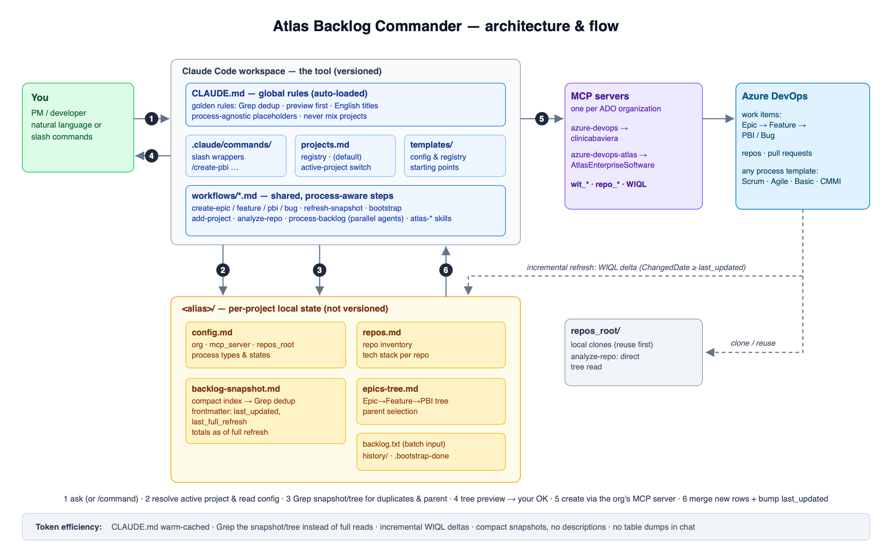

# Atlas Backlog Commander

A Claude Code workspace for managing Azure DevOps backlogs across **multiple organizations and projects** through natural language. You describe the work items you need; the tool checks for duplicates, picks the right parent and repository, shows you a tree preview, and creates them in Azure DevOps after your confirmation.

## What it does

- **Multi-org / multi-project**: each ADO project is registered with an alias in `projects.md` and gets its own folder with a `config.md` (org, project, process, conventions). One MCP server per organization.
- **Process-template aware**: works with Scrum, Agile, Basic, CMMI or custom processes. Work item types (`Product Backlog Item` vs `User Story` vs `Issue`...), states and hierarchy are discovered per project during bootstrap — never hardcoded.
- **Duplicate-safe creation**: a compact backlog snapshot (`<project>/backlog-snapshot.md`) is kept locally and checked before creating anything.
- **Repository-linked items**: every backlog item and bug carries a `## Repository` section; if you don't specify the repo, the tool infers the best candidates and asks.
- **Preview first**: nothing is written to ADO without showing a tree preview tagged with the target project (`[project: <alias> — <org>/<project>]`) and getting your confirmation.
- **Batch mode**: drop plain-language items into `<project>/backlog.txt` and process them in parallel with a consolidated preview.
- **English-only work items**: titles and descriptions are always generated in English.

## How it works



<!-- Azure DevOps does not render SVG in markdown; architecture.svg is the editable source, architecture.png the rendered copy. -->


The numbered flow is the creation path: your prompt is interpreted under `CLAUDE.md`'s rules, the active project is resolved via `projects.md`, duplicates and the parent are checked against the local snapshot/tree (Grep, not full reads), and only after you confirm the tree preview does anything get written to Azure DevOps through the org's MCP server — then the new rows are merged back into the local snapshot.

## Requirements

- [Claude Code](https://claude.com/claude-code) (CLI or desktop app).
- One [Azure DevOps MCP server](https://www.npmjs.com/package/@azure-devops/mcp) per ADO organization, registered at user scope. Any server name works — it is recorded as `mcp_server` in the project's config:

  ```bash
  claude mcp add <server-name> --scope user -- npx -y @azure-devops/mcp <org>
  ```

- Optional: the `atlas-ai-plugins` Claude Code plugin — its `atlas-*` skills generate full .NET Web API / Blazor backlogs and integrate with this workspace (they emit Scrum types, so they apply as-is only when the project's requirement type is `Product Backlog Item`).

## Setup

1. Clone this repository and **always launch Claude Code from its root** — `CLAUDE.md` (the tool's rules) is auto-loaded from there.

   ```bash
   git clone https://github.com/Atlas-Enterprise-Software/atlas-backlog-commander.git
   cd atlas-backlog-commander && claude
   ```

2. Create your project registry from the template: copy `templates/projects.md` to the repo root as `projects.md`.
3. Register your first project — easiest is to just ask Claude (see the first example below); it follows `workflows/add-project.md` and creates the project folder and `config.md` (template: `templates/config.md`) for you.
4. On first use of a project, the tool runs `workflows/bootstrap.md` (after asking you): it detects the process template, scans the project's repos and the whole backlog, and generates the local snapshot and epics tree.

All of this per-project data stays on your machine — see [What is not versioned](#what-is-not-versioned).

## Example: initialize a new project

```text
You:    Add a new project: org Contoso, project ContosoWeb, alias ctw.

Claude: There is no MCP server for the Contoso org yet. Register it and restart the session:
          claude mcp add ctw-ado --scope user -- npx -y @azure-devops/mcp Contoso

        (after restart)
        Registered ctw in projects.md (state: pending-bootstrap) and created ctw/config.md.

You:    trabaja con ctw

Claude: ctw has no bootstrap yet. Shall I run it? It will detect the process template,
        scan the ContosoWeb repos and the full backlog, and generate ctw/backlog-snapshot.md
        and ctw/epics-tree.md.

You:    yes

Claude: Bootstrap done: Agile process (requirement type: User Story, closed states:
        Closed/Removed), 42 repos inventoried in ctw/repos.md, 610 active work items
        indexed. ctw is ready.
```

## Example: create a PBI

```text
You:    Create a backlog item in ctw: add server-side pagination to the customers list.

Claude: No duplicates found in ctw/backlog-snapshot.md. Best repository match:
        Contoso.Customers.WebApi (2 other candidates: Contoso.Web.Client, Contoso.Shared).
        Confirm repository? [Contoso.Customers.WebApi]

You:    yes

Claude: Preview [project: ctw — Contoso/ContosoWeb]:

        Feature #4102 "Customers module improvements" (Active)
        └── User Story (new): "Add server-side pagination to the customers list endpoint"
            ## Repository: Contoso.Customers.WebApi
            Acceptance criteria: page/pageSize query params, total count header, ...

        Create it in Azure DevOps?

You:    yes

Claude: Created User Story #4257, linked to Feature #4102.
        https://dev.azure.com/Contoso/ContosoWeb/_workitems/edit/4257
```

Notes:

- The parent is always an **active** Feature (closed/removed parents are skipped); if none fits, the tool proposes creating one first.
- On a Scrum project the same prompt produces a `Product Backlog Item`; on Basic, an `Issue` — types come from each project's `config.md`.

## Example: create backlog from a text file

Drop your items in plain language (any language) into `<project>/backlog.txt`, one per bullet or paragraph:

```text
- Add server-side pagination to the customers list
- Bug: the appointments export fails when the date range spans two years
- Refactor the notifications service to use the shared retry policy
```

Then ask to process it (or run `/process-backlog`). One agent analyzes each item in parallel — classifying it, inferring the repository and the active parent, drafting title/description/AC in English — and you get **a single consolidated tree preview** flagging possible duplicates. Nothing is created until you confirm; you can also exclude items or adjust their repo/parent before the OK. Processed lines are marked `[OK #id]` in the file, so re-running only picks up what's new (`workflows/process-backlog-file.md`).

## Daily usage

| Task | How |
|------|-----|
| Create an Epic / Feature / PBI / Bug | Just ask, or `/create-epic`, `/create-feature`, `/create-pbi`, `/create-bug` |
| Batch-create items | Write them in plain language in `<project>/backlog.txt`, then `/process-backlog` (`workflows/process-backlog-file.md`) |
| Refresh the backlog snapshot | `/refresh-snapshot`; incremental by default (`workflows/refresh-snapshot.md`) |
| Analyze a repo's structure | `/analyze-repo <RepoName>` (direct tree read of the local clone) |
| Switch active project | "trabaja con `<alias>`" |
| Add another org/project | `/add-project` (`workflows/add-project.md`) |

Every workflow is also available as a slash command (`.claude/commands/`) — thin wrappers over the same `workflows/*.md` files.

## Repository layout

```text
CLAUDE.md          Global rules (auto-loaded by Claude Code) — the tool's brain
workflows/         Shared, project-parameterized step-by-step templates
.claude/commands/  Slash commands (/create-pbi, /refresh-snapshot, ...) wrapping workflows/
templates/         Starting points for your local projects.md and <alias>/config.md
projects.md        (local, not versioned) your project registry
<alias>/           (local, not versioned) one folder per registered project:
                   config.md, repos.md, backlog-snapshot.md, epics-tree.md,
                   history/, backlog.txt, .bootstrap-done
```

## What is not versioned

The `.gitignore` whitelists the tool (`CLAUDE.md`, `workflows/`, `.claude/commands/`, `templates/`, this README) and ignores everything else. Project folders and `projects.md` contain client data (org names, area paths, work item titles, repo inventories) and regenerable state (snapshots, epics trees, bootstrap markers), so they live only on each user's machine.
